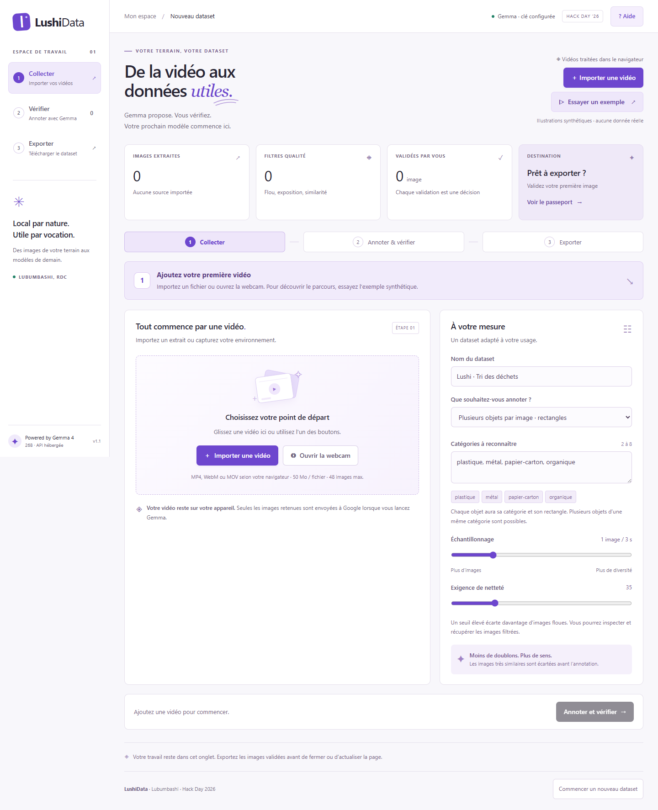

# LushiData ✳

**De la vidéo aux données utiles.** LushiData 1.1 transforme des vidéos ou un flux webcam en datasets de **détection multi-objets** ou de **classification**, pré-annotés par **Gemma 4 hébergé**, puis vérifiés humainement.

> Gemma propose. Vous vérifiez. Chaque dataset conserve ses sources, ses corrections et ses limites.



## Deux modes

- **Plusieurs objets par image — rectangles** (par défaut) : Gemma propose une catégorie et un rectangle pour chaque objet visible, y compris plusieurs instances d’une même catégorie. L’éditeur permet de déplacer, redimensionner, supprimer et dessiner des rectangles. Exports **YOLO, COCO, JSONL et CSV**.
- **Une catégorie pour l’image entière** : classification de l’objet ou du matériau principal. Export ImageFolder, JSONL et CSV.

Le mode et les catégories sont choisis avant la collecte puis verrouillés pour ce dataset. Gemma reste **gemma-4-26b-a4b-it**, appelé en ligne via la Gemini API ; les poids ne sont pas installés localement.

## Parcours

1. Choisir le mode et les catégories.
2. Importer une vidéo autorisée (50 Mo/fichier) ou capturer dix secondes de webcam, sans microphone. La vidéo est décodée dans le navigateur.
3. Inspecter les exclusions de flou, exposition et similarité (dHash). Elles sont réversibles et documentées.
4. Autoriser l’envoi des JPEG sélectionnés à Google et lancer Gemma.
5. Vérifier chaque scène. En détection, corriger les catégories et rectangles, ajouter les objets manquants et supprimer les mauvaises propositions. Une catégorie indéterminée empêche la validation.
6. Valider puis exporter les images revues avec leur passeport.

Une image sans objet exige une confirmation explicite. Modifier une scène déjà validée la remet en attente. Aucune proposition de modèle n’est validée automatiquement.

Le prototype limite la collecte à six sources, 16 images par vidéo et 48 images au total. En détection, les requêtes traitent une image à la fois ; Gemma propose au maximum 20 objets par image et l’éditeur en autorise 50. Les scènes encombrées peuvent rester incomplètes : elles nécessitent une vérification humaine.

## Installation

Node.js 22.15+ ou 24 LTS. Aucun paquet tiers nécessaire.

```sh
git clone https://github.com/SiegK18/LushiData.git
cd LushiData
```

Copier `.env.example` vers `.env` et renseigner :

```dotenv
GEMINI_API_KEY=votre_cle_google_ai_studio
GEMMA_MODEL=gemma-4-26b-a4b-it
PORT=4317
```

```sh
npm run dev
```

Ouvrir **http://127.0.0.1:4317**. La clé reste côté serveur ; `.env` est ignoré par Git.

## Export de détection

```text
dataset.zip
├── images/train/ · val/ · test/*.jpg
├── labels/train/ · val/ · test/*.txt
├── data.yaml
├── coco/train.json · val.json · test.json
├── annotations.jsonl · annotations.csv
├── classes.json · sources.json
├── quality_report.json · dataset_card.md
├── rejected_manifest.json
├── annotation_prompt.txt · annotation_prompts.json
└── checksums.sha256
```

- **YOLO** : chaque ligne contient `class_id x_center y_center width height`, coordonnées normalisées entre 0 et 1. Les indices commencent à 0 et sont définis dans `data.yaml`.
- **COCO** : catégories à partir de 1, rectangles `[x, y, largeur, hauteur]` en pixels. Les `file_name` sont relatifs à la racine du ZIP.
- **JSONL** : une ligne par image, avec tous ses objets, la proposition originale, la décision humaine et la provenance. Les rectangles `box_2d` sont `[ymin, xmin, ymax, xmax]`, normalisés sur 0..1000.
- Une image négative confirmée possède un fichier YOLO vide et aucune annotation COCO.
- Seules les scènes explicitement validées, aux catégories et rectangles valides, sont exportées.

En classification, les images sont rangées dans `train/<classe>/*.jpg`, `val/<classe>/*.jpg` et `test/<classe>/*.jpg`. Vérifier les indices de `classes.json` : certains chargeurs ImageFolder trient les dossiers alphabétiquement.

## Provenance et séparation

L’export contient les sources, les empreintes SHA-256, les consignes exactes envoyées à Gemma, les propositions originales et les corrections. Les données exclues restent documentées sans leurs pixels.

Les vidéos entières restent dans une partition. Un graphe relie aussi les sources dont les images validées sont identiques ou très proches par dHash. Chaque composante connexe reste ensemble. Un seul groupe donne uniquement train ; deux donnent train/val ; à partir de trois, des groupes sont réservés à val et test.

Cette stratégie réduit les fuites entre images voisines ; elle ne garantit ni indépendance sémantique parfaite, ni équilibre, ni ratio fixe. Les partitions ou catégories insuffisantes sont signalées.

## Démonstration et limites

**Essayer un exemple** charge des illustrations synthétiques. En détection, plusieurs objets apparaissent dans chaque scène. Les annotations ne sont pas préfabriquées : le bouton Gemma réalise un appel réel. L’exemple montre le parcours ; ce n’est pas un benchmark de terrain.

Le cas d’usage initial est la préparation de données de tri des déchets. Le gain de temps, la précision, la représentativité locale et l’adoption auprès d’utilisateurs restent à évaluer. L’acceptation d’une proposition par un humain n’est pas une précision scientifique.

Gemma peut manquer des objets, confondre les matériaux ou proposer des rectangles imprécis. La détection porte sur des images échantillonnées ; aucun suivi d’objets entre images ni analyse vidéo en temps réel n’est promis. Les sorties du modèle restent des propositions.

## Fiabilité et confidentialité

Les erreurs réseau et temporaires de Google déclenchent jusqu’à trois tentatives avec attente progressive, dans un budget de 55 secondes. Le nombre de tentatives et le code d’erreur sont conservés sans exposer la clé. Relancer l’annotation conserve les propositions déjà reçues ; aucun échec n’est remplacé par une réponse inventée.

Les vidéos et décisions restent en mémoire dans l’onglet : **exporter avant fermeture ou rechargement**. Aucun stockage applicatif durable serveur. Les seuls pixels transmis à Google sont les JPEG sélectionnés après action explicite ; les politiques de Google restent applicables.

Le serveur local écoute seulement 127.0.0.1. Le proxy doit rester privé ou authentifié avant exposition publique. Les données importées conservent leurs propres droits ; la licence du code n’accorde aucun droit sur les vidéos.

## Architecture et vérification

Navigateur : vidéo/webcam → Canvas → filtres → JPEG → proxy → Gemma 4 → propositions → éditeur humain → partitions par source → ZIP.

`src/core.js` contient formats, contrôles et partitions ; `src/server.js` le proxy et la validation des réponses ; `src/detection-editor.js` l’éditeur de rectangles ; `src/app.js` le parcours. Le build produit un Worker ESM autonome.

```sh
npm run check
```

Les [vérifications](docs/VALIDATION.md) distinguent tests automatiques, parcours navigateur et appels réels. Voir aussi le [pitch](docs/PITCH.md), la [feuille de route](ROADMAP.md) et [CONTRIBUTING.md](CONTRIBUTING.md). Les neuf critères officiels locaux n’ont pas été fournis ; aucune note de jury n’est affirmée.

Code : [MIT](LICENSE). Illustrations procédurales : CC0-1.0. Données importées : droits propres.

[Gemma : compréhension d’images et détection](https://ai.google.dev/gemma/docs/capabilities/vision/image) · [Gemma hébergé via la Gemini API](https://ai.google.dev/gemma/docs/core/gemma_on_gemini_api)

**Hack Day 2026 · Lubumbashi**
